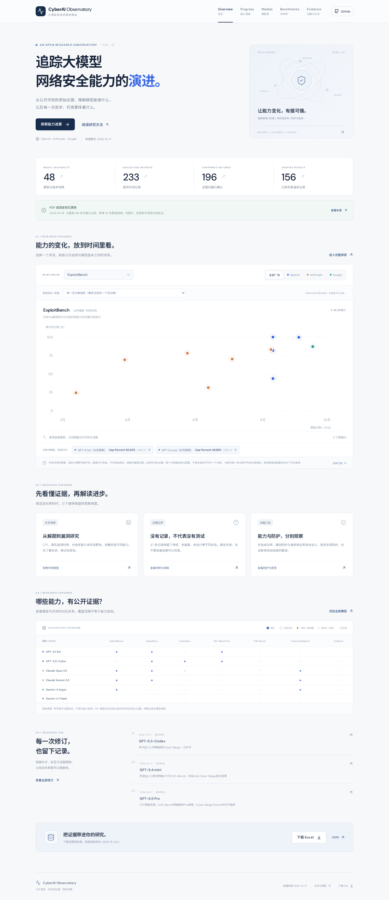

# CyberAI Observatory

**追踪大模型网络安全能力的演进，让每个结果都能回到证据。**

[浏览网站](https://hongkun16.github.io/cyberai-observatory/) · [能力进展](https://hongkun16.github.io/cyberai-observatory/#progress) · [研究方法](docs/methodology.md) · [下载成绩补录版 Excel](web/public/downloads/audit-2026-10-18.xlsx)

基于公开模型报告的证据资料库与交互网站。报告快照 **2026-10-17**：**48** 个模型 / 版本、**233** 条逐项记录、**196** 条证据归属已确认。**2026-10-18 已逐项复核全部196条已确认记录的PDF正文、表格及图表，新增113条数值成绩，现有156条数值记录、315项分配置指标。**项目没有独立重跑模型评测。



## 可以探索什么

- **能力进展：**按评测与厂商筛选公开成绩；点击数据点查看原始指标、运行配置、章节和 PDF 文件页码。
- **模型库：**48 个版本档案，支持搜索和模型 × 评测覆盖矩阵。
- **评测库：**49 个评测 / 任务标签的定义、开放性和比较限制。
- **证据与方法：**233 条记录可检索、可分享深链接，另有 20 项核验修订和数据下载。
- **下载：**Excel、CSV、完整 JSON；PDF 目录保留官方来源、页数与 SHA-256。

## 如何解释图表

156 条记录已核实数值，22 条仅有未标精确值的曲线，18 条只有定性结论，37 条因证据未确认而不适用。原43条成绩也已复核。所有补录保留PDF路径、文件页码、原文摘录或图表读数、哈希和配置，详见 [成绩补录说明](docs/score-audit.md)。

散点图支持选择指标与配置，默认显示每条记录中唯一的百分数指标。多个预算、防护开关及指标分别保留；次数指标可单独绘图，混合指标不平均。月精度结果在图下单列。只有曲线而没有精确数值标签的结果不估读。

**同名评测不自动可比。**题集、指标、采样预算、工具环境和防护设置可能不同，目前不连接数据点、不计算综合排名。横轴为模型日期；后续报告补测在记录中另行标注。覆盖项目增加也不等于能力提升。

“已确认”确认的是模型与测试的证据对应关系，不能解读为全部任务成功或独立复现。缺失记录、未披露、待核、明确未运行和排除状态分别保留。

## 本地运行

需要 Node.js 22、npm 和 Python 3.10+。数据导入使用Python标准库，补录版Excel导出另需openpyxl。

```bash
npm ci
python3 -m pip install -r requirements.txt
npm run data:import
npm run dev
```

构建和验证：

```bash
npm run test:data
npm run build
npx playwright install --with-deps chromium
npm run preview -- --port 4173
# 在另一终端运行
npm run test:web
```

构建产物位于 `dist/`。浏览器测试覆盖桌面 / 手机、键盘操作数据点、证据深链接、筛选、模型矩阵、评测详情与下载。

## 数据流程与目录

```text
snapshots/2026-10-17.xlsx + data/score-audit/*.json
          ↓ scripts/import_workbook.py + scripts/export_workbook.py
data/                    # 标准模型、记录、评测、来源、修订、PDF 目录
          ↓
web/public/data/         # 网站完整 JSON
web/public/downloads/    # CSV / Excel 下载
          ↓ React + TypeScript + Vite
dist/                    # 静态网站
```

`data/model-identities.json` 保存模型 ID 及经整理的日期精度。`data/record-identities.json` 保存证据记录身份；修正配置、成绩或状态时保留原 ID。具体字段见 [数据字典](docs/data-dictionary.md)。PDF成绩复核层按厂商保存在 `data/score-audit/`，原始成绩及配置保留在 `originalScore`、`originalConfiguration`。

原始Excel是记录、归属和来源索引的快照；逐项PDF复核JSON是成绩补录与配置纠正的来源。两者合并生成结构化数据、CSV及补录版Excel（含新增“成绩补录审计”表）。原始Excel完整保留，不覆盖历史证据。生成的Excel采用固定时间戳，可重复构建。

## 部署与维护

推送 `main` 后，GitHub Actions 会重新导入工作簿、校验数据、构建、执行浏览器检查，再部署 GitHub Pages。PR 执行同样检查但不部署。项目站点路径通过 `VITE_BASE_PATH` 设置，使用哈希导航以支持刷新和直接分享。

PDF 原文不进入 Git 历史。可从目录中的官方链接访问；现有本地资料包可作为版本归档单独保存。网站链接与导出的 JSON 均保留原始来源。

[贡献方式](CONTRIBUTING.md) · [更新记录](CHANGELOG.md) · [下一步](ROADMAP.md)

## 许可与引用

MIT 许可适用于本项目原创代码。第三方报告和引用内容保留原权利；整理数据未另行声明独立再分发许可。请在使用具体成绩时引用原报告与运行设置。

```text
CyberAI Observatory. 模型网安评测核验快照. 2026-10-17.
https://github.com/Hongkun16/cyberai-observatory
公开报告证据整理；未独立重跑模型评测。
```
